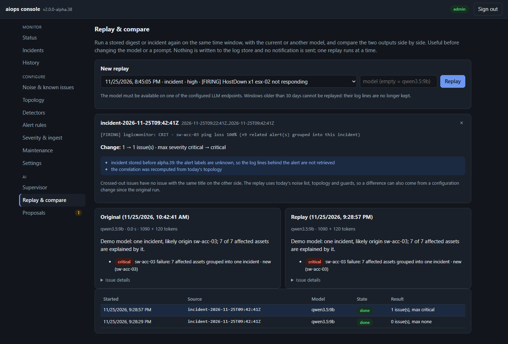
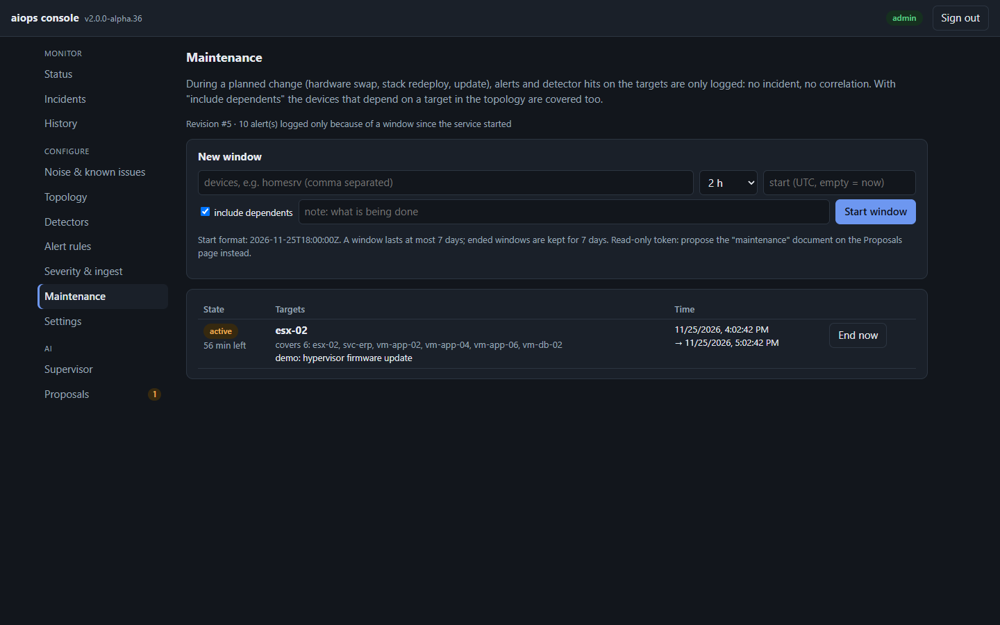
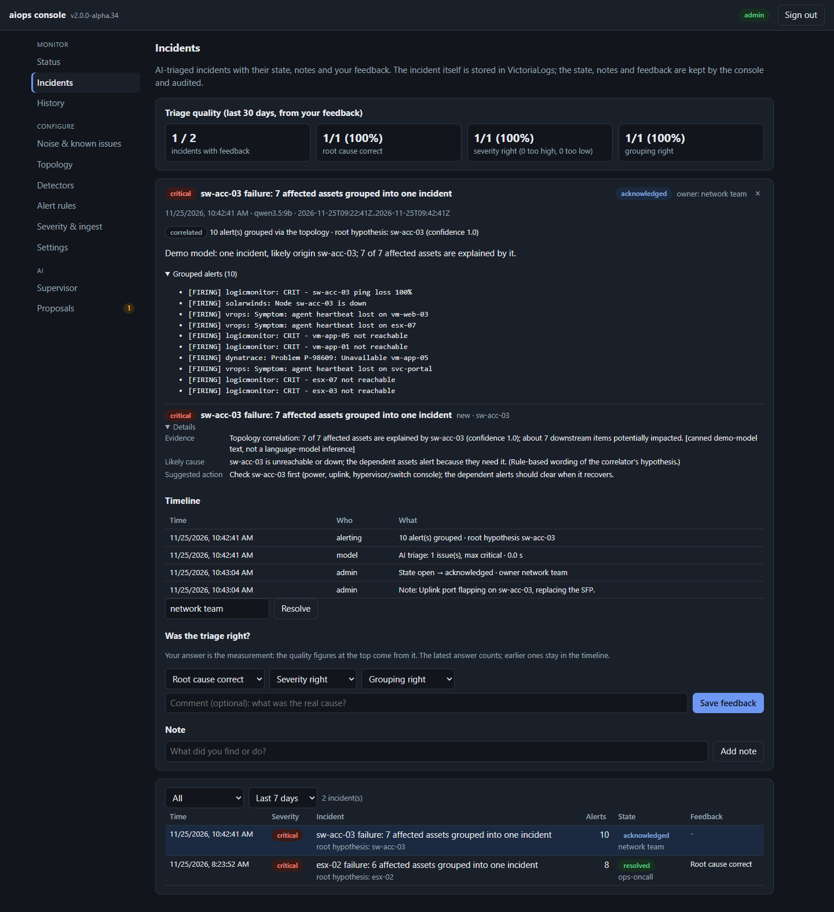
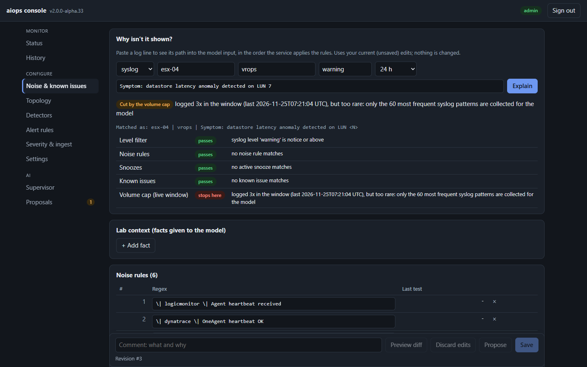

# Changelog

All notable changes of aiops-console. The format follows [Keep a Changelog](https://keepachangelog.com/en/1.1.0/);
versions are [SemVer](https://semver.org/) pre-releases (`2.0.0-alpha.N`). The release job publishes the entry of a tag as its
GitHub Release notes, and a test checks that the version in `src/aiops.py` has an entry here.

## [2.0.0-alpha.44] - 2026-11-28

### Blocking CI gates, a slimmer image and isolated tests
- **Why:** the report-only gates of alpha.43 found 12 lint issues (unused imports and variables) and HIGH findings in the image: one in Debian (`libzstd1`) and five in pip's own vendored libraries (msgpack, urllib3, pkg_resources/setuptools), which the console never uses.
- **What changed:** the lint issues are fixed (no behaviour change). The image applies Debian security updates at build time and removes pip after installing the dependencies. Lint, `node --check`, `pip-audit` and the Trivy scan (HIGH/CRITICAL with an available fix) now **fail the build**, and `publish` also depends on the quality job. Coverage stays report-only. A justified scan exception goes into `.trivyignore` with a reason and a review date.
- **Test isolation:** every test class now derives from `tests/_base.py` `IsolatedTestCase`. After each test it restores the module-level state (configuration, rule-sync worker, detectors, topology, status; dicts in place), drains the work queues, and **fails the test if a thread it started is still running after 5 s**. Before this, 126 tests left the previous test's store in the rule-sync worker (the cause of the alpha.42 tag-build flake), and two tests left a fake HTTP server's request thread behind. A nightly workflow (`nightly.yml`) runs the whole suite three times in a row to catch tests that fail only sometimes.
- **Trade-off:** there is no `pip` inside the container any more (debugging needs a separate image). `apt-get upgrade` makes builds less reproducible: two builds of the same commit can differ in Debian patch level. A newly published CVE can stop a release that passed the day before; that is intended, the fix is a rebuild or a dated `.trivyignore` entry.

## [2.0.0-alpha.43] - 2026-11-27

### Release safety and CI gates
- **Why:** a failed tag build left no image behind while the release looked done, and a stale image tag in a compose file was only caught by hand.
- **What changed:** no application behaviour. CI now has a container smoke test before publishing (read-only start, health, version, non-root) and a version-consistency test; `publish` depends on both. Lint (ruff `E9,F`), `node --check` on the UI, `pip-audit`, coverage and a Trivy image scan run on every push but only **report** for now (see the run summary); they will become blocking once the existing findings are cleared.
- **Trade-off:** CI takes a few minutes longer (image build and scan on every push).

## [2.0.0-alpha.42] - 2026-11-27

### Operator role
- **Why:** with only read and admin, whoever works the incidents (sets the state, writes notes, rates the triage, opens a maintenance window) needed the admin token, which can also rewrite the noise list, the rules and the settings. In a team that is too much for daily work.
- **What it allows:** a third token, `CONSOLE_OPERATOR_TOKEN` (optional). It has every read right plus: incident state, notes and feedback; replays; maintenance windows (at most 168 h, as before) and ending them; dismissing novelty findings; a manual digest. Every action is in the audit log under `operator:<actor>`.
- **What stays admin-only:** writing and rolling back configuration (noise list, snoozes, topology, detectors, rules, settings, ingest), approving or rejecting proposals, the rule sync, the supervisor run, the test notification and reading the audit log. The operator can still *propose* such changes, like the read token.
- **Compatibility:** without `CONSOLE_OPERATOR_TOKEN` nothing changes. If two roles get the same token, the higher role wins and a warning is logged.
- **Trade-off:** a maintenance window suppresses alerts on its targets, so an operator can silence a device for up to a week; the window is audited and expires by itself, but it is not a proposal. Snoozes stay admin-only because they change the noise configuration (up to 90 days).

## [2.0.0-alpha.41] - 2026-11-27

### Uptime Kuma monitors point at the monitored machine
- **The problem:** a Kuma monitor's log lines come from the machine Kuma runs on, so the model put that machine into the issue's hosts. A game-server monitor going down was reported on the monitoring host instead of the external server it checks, and the incident focus and correlation followed the wrong machine.
- **What the code does now:** it reads the monitor names from the Kuma container log (`Monitor #N 'name'`) and the Kuma webhook events (`[name] [Down] ...`), and resolves each to a machine through the topology: first the name (an alias such as `GameSRV`), otherwise the first address in the message (the `PING` or `ECONNREFUSED` target). A container or service resolves to the machine it runs on. When an issue names a monitor and its hosts are empty or contain Kuma's own machine, the monitored machine is added and Kuma's machine is removed, unless the issue has other, non-Kuma evidence lines there. The change is listed in the guard notes.
- **Also:** "Failed to refresh device state ..." (Tuya) and the alert text itself (`[FIRING] ... LE ALLT`) now count as *symptom only* cause lines.
- **Measured on real runs (replayed):** the CS 1.6 monitor incident moved from the monitoring host to the game server; in two daily digests the game-server and a speaker monitor were attributed to their targets; issues without a monitor were unchanged.
- **Trade-off:** it relies on the topology. A monitor whose name and message match no device stays where it was, and a monitor named after one device while checking another is attributed to the named one. Names shorter than 5 letters are used only when they directly name a device (a group such as `Game` is skipped).

## [2.0.0-alpha.40] - 2026-11-26

### Grounded causes and single-burst severity
- **The cause must quote a line:** for every issue the model now also returns `cause_quote`, a verbatim fragment of one input line that shows *why* it failed. The code checks the quote against the input (numbers and quoting ignored) and labels the cause: **from log** (the line is there), **symptom only** (the line is there but only shows *that* it failed: a systemd exit code, "Failed all N attempts", a bare traceback header), **inferred** (no quote, or a quote that is not in the input; the quote is dropped) or **unknown** (the model says so, starting `likely_cause` with "Unknown:"). The label and the quoted line show in the issue details.
- **Single short burst means at most low:** an issue whose evidence lines all fall in one burst shorter than 2 minutes is capped at `low`, or at `medium` when a Kuma "down" or a critical/high alert names its host or service. The prompt already asked for this; the model did not always follow it.
- **Why:** of 6 incidents rated in the last 30 days, the root cause was rated correct once. The model guessed ("likely a USB disk" for an NFS mount, "possibly permissions, a full disk or a misconfiguration" for a logrotate failure whose log said otherwise) and 4 of 8 severities were rated too high. Replayed on the same 7 incidents: no listed guesses left; 2 causes are now "unknown" and 3 "symptom only" instead of a confident wrong cause; the 4 too-high severities went to the rated level in 3 cases.
- **Trade-off:** the label checks that a line *exists*, not that it really explains the issue; a fitting but wrong line still shows as "from log". Asking for the quote made the model more confident in severity (a 2-line Bluetooth burst went from `low` to `high`), which is why the burst cap came with it; a one-off but serious event (e.g. a single kernel error) is now also at most `medium`.

## [2.0.0-alpha.39] - 2026-11-25

### Replay & compare
- **Same window, another model or today's rules:** the Replay & compare page (and `POST /api/v1/replays`) runs a stored digest or incident again on its original time window and shows the original and the new output side by side: issue count, highest severity, run time, summary, issues (an issue with no same-titled issue on the other side is crossed out), guard notes. The model can be any model served by a configured LLM endpoint; empty means the current one. An incident can be replayed from its own page ("Replay…").
- **Safe to run:** nothing is written to the log store, no notification is sent, and the live state is not touched. One replay runs at a time (the model host is shared with the live triage); a restart marks a running replay as interrupted. Every start is audited.
- **What is replayed:** incidents now store their alert details (labels, detector, correlation) in the incident head, so a replay retrieves the same evidence lines. Incidents stored before this version only have the alert texts: their evidence lines are not retrieved, and the correlation is recomputed from today's topology; the page says so.
- **Why:** comparing two models or a prompt change on the same incidents was a manual job; it is also how a build-vs-buy evaluation compares outputs on the same data.
- **Trade-off:** the replay uses today's noise list, topology and guards, so a difference can come from a configuration change as well as from the model. Windows older than the log retention (30 days, `REPLAY_MAX_DAYS`) cannot be replayed; if VictoriaLogs also has a disk cap, old lines may be gone sooner and the replay sees fewer of them. A replay takes the model host for as long as a live run does.

## [2.0.0-alpha.38] - 2026-11-25

### Incident focus and resolved-issue severity
- **Incidents stay on the alert:** an incident now reports only the issues connected to the alert: an issue is connected when its title, evidence or hosts name something the alert names (label values, the detector's group, the hosts and services of the evidence lines, the devices the topology recognises and everything that depends on them). Unrelated issues up to `medium` move out of the incident and are listed under "Unrelated to the alert, left to the daily digest"; sentences about them are removed from the summary. Unrelated `high`/`critical` issues stay. If no issue names the alert, nothing changes.
- **Resolved means at most low:** an issue the model marks `resolved` is capped at `low`, or at `medium` when a Kuma "down" or a critical/high alert names its host or service (a real outage that has recovered). Applies to digests and incidents.
- **Why:** an alert about Home Assistant errors also reported an unrelated database warning on the NAS, and a resolved backup failure stayed `medium` in the digest. Replayed on a week of real incidents, 19 of 78 issues would have moved to the digest (mostly unrelated device and add-on warnings).
- **Trade-off:** an unrelated `medium` problem found during an incident only shows up in the next daily digest; a resolved failure with lasting damage (e.g. lost data) is also capped at `low`/`medium`.

## [2.0.0-alpha.37] - 2026-11-25

### Maintenance windows
- **Planned work stays quiet:** a maintenance window names devices from the topology (or plain host names without one), a start and an end (at most 7 days). Alerts and detector hits on those devices, and with `include_dependents` on everything that depends on them in the topology, are only logged: no incident, no correlation, no direct notification from a detector. Alerts that Alertmanager routes straight to the notifier (`notify: direct`) are not touched by the console; silence those in Alertmanager if needed. The Status page shows a banner while a window is active.
- **Versioned like the other documents** (`maintenance` key): history, rollback, audit, and proposals for a read token. The Maintenance page and `POST /api/v1/maintenance` start a window in one step; `.../end` ends it early. Windows that ended more than 7 days ago are pruned on the next change.
- **Why:** a stack redeploy produced false incidents (log shipping briefly down, a SMART alert re-firing after Alertmanager restarted), and a host swap would produce many more. In the demo, a window on a hypervisor with its dependents kept a 10-alert storm out of the incident list.
- **Trade-off:** a real, unrelated failure on a covered device during the window is only logged, too. Keep windows short and targeted; the logged alerts stay in VictoriaLogs.

## [2.0.0-alpha.36] - 2026-11-25

### Known-issue alerts and a stricter root-cause hypothesis
- **Known-issue alerts:** a known issue can now carry an optional `match_alert` regex. A firing alert whose text matches it is only logged: it opens no incident and does not join the correlation. Without `match_alert` nothing changes (the input and output regexes are written for log lines and model text, and are too broad for alert text). A `match_alert` that matches a generic alert (e.g. any `DiskSmartFailed`) is rejected: it has to name the host and the device.
- **Root-cause hypothesis only with support:** the correlator names a root cause only when it explains at least two *dependent* alerting assets. Before, two alerts that arrived together were enough: a known SMART alert on a NAS became the "root cause, confidence 1.0" of an unrelated audio error on a host that mounts the NAS. The alerts are still grouped; they just get no hypothesis. Storms are unaffected (synthetic eval: root cause 8/8 before and after).
- **Trade-off:** a real "one host failed and one dependent service alerts" case also gets no hypothesis now; and while a known issue's `match_alert` is set, a new, worse failure that raises the same alert text opens no incident either.

## [2.0.0-alpha.35] - 2026-11-25

### Incident workbench and triage feedback
- **Incidents page:** every AI-triaged incident with its state (open, acknowledged, resolved), owner and feedback; filter by state and window. The detail view shows the grouped alerts, the root-cause hypothesis, the issues, what the guards changed, and a timeline (alerting, AI triage, state changes, notes, feedback).
- **Feedback is the measurement:** an admin answers three questions per incident: was the root cause correct, was the severity right (or too high / too low), was the grouping right (or should it be split / merged). The latest answer counts; the page shows the rates for the last 30 days (`GET /api/v1/incidents/quality`). These are the labels a build-vs-buy comparison needs, collected in the tool itself.
- **Storage:** the incident stays in VictoriaLogs (`pipeline:ai`); the console keeps only the state, notes and feedback (SQLite, audited). New incidents also store their grouped alerts (`alert_items`); older ones show the first alert.
- **Trade-off:** changing the state, adding notes and giving feedback needs an operator or admin token (the operator role came in alpha.42).
- **Fix:** "Why isn't it shown?" no longer calls a line "too rare" when the typed text differs slightly from the logged one (e.g. a device name); it uses the closest collected pattern and says so.

## [2.0.0-alpha.34] - 2026-11-25

### "Why isn't it shown?"
- **Explain a log line:** a panel on the Noise & known issues page (and `POST /api/v1/explain`) takes a host, an ident or container, a message, its source and level, and shows the line's path into the model input in the order the service applies it: level filter, noise rules (which rule, by number), snoozes (active or expired), known issues, and the volume cap in the live window (its rank among the kept patterns, or "logged N times but too rare" from a targeted search). It uses the unsaved edits on the page and changes nothing. A line listed under Never suppress is flagged.
- **What it showed straight away:** rare patterns (a few lines a day) that are below the most frequent 60 syslog / 80 journald / 200 Docker patterns never reach the daily digest; only the new-pattern scan sees them. The explanation now says so instead of leaving it to guesswork.
- **Severity & ingest page:** the effective mapping wraps inside its card instead of running off the right edge.

## [2.0.0-alpha.33] - 2026-11-25

### Error-level cap, informational alerts and guard-consistent summary
- **Summary follows the guards:** when a guard lowers an issue's severity or marks it `resolved`, the summary is rebuilt from the final issues (`N issue(s): [medium] ...; [low, resolved] ...`), resolved ones last. Before, the model's text still said "is failing" for issues the stale guard had already resolved. Trade-off: the model's free-text summary is replaced by a terse list on those days.
- **Error-level cap in the daily digest:** a `high` or `critical` issue whose every evidence pattern is at most error level (syslog `err`, journald `PRIORITY` 3, error-like Docker lines) is capped at *medium*, unless a Kuma "down" event or a `critical`/`high` alert in the window names the same host or source. This is the digest counterpart of the incident rule from alpha.23; the journald query now also groups by `PRIORITY`. Trade-off: a genuinely severe problem that only logs at error level stays *medium* in the digest (incidents are unaffected).
- **Informational alerts:** alert events with `notify: none` or `severity: info` are tagged `[informational]` in the model input, and the prompt says that a graceful restart (exit code 0) is not a crash. Before, an inhibition-source alert for a planned Home Assistant update was reported as "Repeated crashes, high".

## [2.0.0-alpha.32] - 2026-11-24

### Stale-issue guard and known-issue mentions
- **Stale-issue guard (deterministic):** a `new` or `ongoing` issue whose every evidence pattern (host in the issue's hosts, source/container name in its title or evidence) stopped more than 2 hours before the end of the window becomes `resolved` and is capped at *low*; the summary starts with `[guard: ...]`. The model was given the timing in alpha.31 but still kept a one-off burst from four hours earlier as `medium/ongoing`. An issue with no identifiable evidence pattern, or with any recent or undated pattern, is left unchanged, so the guard can only lower, never raise.
- **Known issues in the summary:** the prompt now says not to mention known issues in the summary. If the summary still refers to one (it matches a known issue's output regex, or the input had a "Known issues present" section and the summary says "acknowledged" / "known issue"), it is rebuilt from the remaining issues, as when a known issue is dropped.

## [2.0.0-alpha.31] - 2026-11-24

### Digest quality: timing and consistent summary
- **Timing per pattern:** the model input now shows, for every syslog, journald and per-container Docker pattern, when it first and last occurred relative to the end of the window (`single burst, last 2h before end`, `over 17h, last <15m before end`). The prompt says that lines which stopped hours before the end are not ongoing, and that a single burst or a few lines spread over many hours are low. Before, the model saw only counts and rated a one-off burst or a handful of reconnects as an ongoing high-severity problem.
- **Consistent summary:** when the post-filter drops a known issue, the summary is rebuilt from the remaining issues (`N issue(s): [sev] title; ... (K known issue(s) left out)`), so a dropped known issue can no longer be named as "the most critical" one.
- **Latest Kuma/alert events:** the "Kuma and alert events" section shows the 12 most recent events of the window (in time order), not the 12 oldest.

## [2.0.0-alpha.30] - 2026-11-23

### Security hardening from the second audit
Fixes from a second static security review (enterprise-adoption view):
- **ReDoS guard:** a regex is now analysed before it ever runs: nested unbounded repeats `(x+)+`, repeated alternation `(a|aa)+`, two overlapping repeats side by side (`.*.*`, `\w+\d+`), more than 3 very broad repeats on one path, or over 500 characters are rejected. The timed probe also uses strings built from the regex's own prefix, and a failing probe process now rejects (fail-closed). The Supervisor runs the guard before testing a model regex in-process, and a model-proposed noise regex may not contain alternation; login, sudo, user-creation and disk-I/O lines are canaries.
- **Queries:** a filter can no longer close the surrounding parenthesis (`x) OR (y` escaped the time window). A rule's `note` may not contain `{{ }}` (vmalert would template it). `group_by` may not use `_msg`, `_time`, `_stream` or `message`. The release dry run is time-bounded to what vmalert evaluates, row- and size-limited, and a timeout or more than 200 result rows rejects the release.
- **Evidence:** an incident is skipped as "all noise" only if the evidence list is complete and no suppressed line is critical (PRIORITY <= 2).
- **Config:** a known issue may not match generic text; the 90-day snooze cap also applies to a full document.
- **Abuse limits:** the pending-proposal limit counts per role, not per `X-Actor` label; the audit log is kept for 400 days instead of the last 2000 rows.
- **Secrets:** redaction covers Azure/SAS connection strings, `Pwd=`/`pass=`, PGP and PuTTY private keys, GCP/OpenAI/Anthropic/GitHub/Slack tokens, `X-Api-Key`, `Cookie` and URL passwords containing `/`.
- **LLM keys:** `LLM_API_KEY`/`SUPERVISOR_KEY` are sent only to hosts of the endpoints set in the environment or listed in `ALLOWED_LLM_HOSTS`; with a non-empty list the settings only accept endpoint URLs on those hosts.
Open (not code fixes): authentication (SSO/OIDC, TLS), alert ingestion authentication on the log pipeline, deterministic notifications independent of the model, security logging/SIEM export, data residency policy, signed and digest-pinned images. These need decisions outside the code.

## [2.0.0-alpha.29] - 2026-11-23

### LLM endpoint check job
A background job now checks **every** configured LLM endpoint on its own schedule (setting `ENDPOINT_CHECK_S`, 15-600 s, default 60): it asks only whether the endpoint is reachable and the model is present (`/api/tags`, `/v1/models`), it never calls the model. The Status page shows up/down per endpoint with the time of the last check, the response time and the reason when down. Before, only the endpoint a job or the heartbeat happened to probe showed a fresh state; the ones behind it stayed "unknown". An endpoint that comes back is used immediately (the back-off of failed generations is cleared); one that is down is not tried by jobs until the next check. A changed endpoint list or model is checked at once.

## [2.0.0-alpha.28] - 2026-11-23

### Alert rules: release to vmalert
An approved `rules` revision can now reach vmalert. Off by default: it needs the environment variables `VMALERT_URL` and `RULES_DIR` (the folder shared with vmalert, mounted read-write here and read-only in vmalert, which gets `-rule=<folder>/*.yml`) **and** the setting `RULES_SYNC=on` (Settings page). A release: (1) every enabled rule's expression is run against VictoriaLogs (a rejection or an unreachable VictoriaLogs stops the release before anything is written; vmalert itself does not check LogsQL at load time); (2) the file is replaced atomically; (3) `POST /-/reload`, then the console checks `vmalert_config_last_reload_successful` and that vmalert lists exactly the expected `aiops-console-*` groups and rules, none in an error state; (4) on any failure the previous file is restored and vmalert reloaded again, the state becomes `error` and the revision stays saved (nothing flips back silently: re-apply, fix or roll back by hand). With no enabled rule the file is removed (keep a placeholder file in the folder so the glob never matches nothing). Limit: a rule that fails only when vmalert evaluates it (health `err`) is shown in the live view, not caught at release time. Rules with `notify: none` are logged but never triaged (the alert stays in the store as `appname:alert`).

## [2.0.0-alpha.27] - 2026-11-23

### Alert rules
Detection runs in vmalert + Alertmanager; this console becomes the place where the vmalert rules are managed (proposal, approval, revision, audit). alpha.27 adds the foundation, **without touching vmalert**: a new versioned config key `rules` (validated like the others, via `PUT /config/rules` or a proposal), the rule kinds `count`, `silence`, `absent` and `raw` (expert LogsQL with a `stats` pipe), `GET/POST /api/v1/rules/preview` which renders the vmalert rule file (deterministic, every text JSON-quoted into the YAML) and an *Alert rules* page (edit the JSON, validate & render, diff, propose, save). Safety: the summary template may only use `{{ $value }}` and `{{ $labels.<field> }}` (other vmalert template functions, e.g. `query`, are rejected); fields that do not belong to a kind are rejected. Saving a revision does not change vmalert yet: writing the file and reloading vmalert is the next step.

## [2.0.0-alpha.23] - 2026-11-21

### Incident severity guard
A small model can turn one harmless error line into a "critical outage" and name a service that appears nowhere in the evidence. Two deterministic checks now run on every incident the model writes, independent of the model: (1) if the evidence behind a journald alert is error-level only (PRIORITY 3, nothing at crit/alert/emerg), the severity is capped at *medium*; (2) if the output names a service from the lab facts or the topology (e.g. Immich) that is not in the input, the severity is capped at *low*, which is below the notification floor. The summary then starts with `[guard: ...]` saying what was changed; the issue and its evidence stay visible. Detector-driven incidents are not capped. It never raises a severity; known limit: only names from the lab facts and topology are checked. (alpha.24: the name list is deliberately narrow, proper nouns from the lab facts plus topology ids that contain a digit, minus a list of generic words; a too-broad list would cap real incidents.) (alpha.25: a third rule for detector-driven incidents: the severity can not exceed the detector's configured severity, because a narrow, human-written condition gives the model no evidence for "dependent services fail"; for a bundle of alerts only if every item is a detector, then the highest configured one. Limit: an unrelated, more severe problem found in the same window is capped too; the daily digest still reports it at its real severity.) (alpha.26: a fourth rule for "thin evidence": an incident triggered only by log-silence alerts (SyslogSourceSilent, DockerLogsSilent, JournaldSilent), with no line-level evidence and only up to 5 kept log lines in the window is capped at *medium*, because a handful of lines does not support "high" (a single MariaDB `[Warning] Aborted connection` line once became a "high" incident). The alert's own severity, e.g. vmalert `notify: direct`, is unaffected. Limit: a real but sparse problem is capped at medium too, which is still above the notification floor.)

## [2.0.0-alpha.22] - 2026-11-21

### Detector oversight
Detector drafts used to arrive disabled and stay that way. Now: *Approve* on a detector proposal has an *enable the new detector* tick (a second revision, easy to roll back); the new-pattern list has a *+ detector* button that drafts a detector from the finding (host + source + the longest constant phrase of the pattern, no model) with a 7-day backtest and the same noise ceiling the supervisor uses; the Detectors page has a *Detector health* panel (firings in 30 days, approved drafts still disabled, noisy, failing; `GET /api/v1/detectors/health`) and the supervisor overview reports waiting drafts and noisy detectors; the supervisor's *coverage_gap* task also considers error-level open findings, not only the log groups it queries itself.

## [2.0.0-alpha.21] - 2026-11-21

### Findings list and proposal evidence
New-pattern findings that a noise rule now covers are closed automatically when the rule is approved (the detector already skipped them for new matches). The list defaults to *warning and above* (info/debug are one click away), can be grouped by host with a per-host *Dismiss*, and has *Dismiss likely noise* (advisory marks only, with confirmation; `POST /api/v1/novelty/dismiss` with `{\"ids\": [...]}`). Noise-rule proposals show deterministic evidence instead of a model's opinion: patterns/lines/hosts in the 7-day baseline, levels, the open findings the rule would close, redacted example lines, overlapping existing rules, and a *check carefully* flag when the rule or the covered lines touch security/availability keywords (preauth, denied, OOM, pairing, ...). A flag, not a verdict.

## [2.0.0-alpha.20] - 2026-11-21

### Proposals paging
The proposals list used to show only the newest 50, so older pending proposals could not be reached in the UI. `GET /api/v1/proposals` now takes `limit` (1-200), `before` (id of the last item of the previous page) and `status`; the Proposals page has a state filter and a *Load older proposals* button.

## [2.0.0-alpha.19] - 2026-11-21

### Noise advisor
A tiny text classifier (Naive Bayes, standard library only, ~10 microseconds per pattern) trained on your own noise rules marks new patterns as *likely noise* and lets the Supervisor start with the most likely candidates. **Advisory only:** it never filters, never creates a rule, and never marks error-level lines, `must_keep` samples or known issues. The threshold comes from grouped cross-validation (the highest score of any held-out important line). Switch: `NOISE_ADVISOR=on|off` (Settings page). Measure it with `python -m evalkit noise-model --data DIR --known known.json`. Measured on real logs: 46 of 50 hand-labelled suggestions were noise, 0 were not (4 unsure), but it only covers the long tail (~5% of the unlabelled volume) and cannot guarantee that an unseen critical line survives, so it is not a filter. Details: `docs/aiops-merokeret.md`.

## [2.0.0-alpha.17] - 2026-11-19

### Severity & ingest page, demo model
New *Severity & ingest* page and a *Never suppress* panel in the UI (see the notes above); the demo environment ships a deterministic stand-in model so the incident flow runs without a real LLM.

## [2.0.0-alpha.16] - 2026-11-19

### must_keep, severity normalisation, demo
`known.must_keep` lists sample lines that no noise rule or snooze may suppress (checked on every config write, proposal and approval). The `ingest` config document maps tool-specific severities and field names to one scale (`evalkit import` converts exports with it). `demo/` and `report --html` are new (see `demo/README.md`). Later in the same line of work: a *Severity & ingest* page (mapping editor, try-a-value, effective mapping; `GET /api/v1/config/ingest`, `POST /api/v1/test/ingest`), a *Never suppress* panel on the Noise page with a live conflict hint, and a deterministic demo model (`demo/mock_llm.py`). Note: a `known` document with `must_keep` is rejected by v2.0.0-alpha.15 and earlier.

## [2.0.0-alpha.15] - 2026-11-18

### Faster correlation
`correlation.cluster()` no longer compares every pair of alerts: the relation depends only on the *set* of assets an alert names, so alerts with the same set are handled together and the relation is computed once per pair of distinct sets (cached); the time-window merge is a two-pointer sweep. The result is identical to the previous algorithm (kept as `cluster_pairwise()` for tests): 1,600 alerts in one window took 5.2 s, now 0.008 s; 25,000 take 0.13 s. Worst case (almost every alert a unique multi-asset set) remains quadratic.

## [2.0.0-alpha.14] - 2026-11-17

### Noise-regex scope backtest and security hardening
- Before a noise suggestion is filed, its regex is run over the last 7 days of the referenced source(s) (same text and matching as the live noise list). The proposal comment shows lines / templates / hosts, how many referenced patterns it covers, and the other templates of the same source it would also silence. It is rejected when it would also silence an error-like line or more than 10 other templates.
- Regexes in the `known` document are probed in a separate process with a time limit before they are accepted (catastrophic-backtracking guard, `regex_guard.py`).
- The secret filter (`redact.py`) now also covers the triage path (model input and output); new shapes: JWT, AWS key ids, `user:password@` in URLs, game-server commands.
- API: the unauthenticated `/last` returns metadata only; failed-token attempts are limited per client (429 after 10/min); request bodies are capped at 256 KB; at most 100 pending proposals per actor; API responses are `no-store` / `nosniff`; upstream error details stay in the service log. Use tokens of at least 32 random characters.
- Details and the open items: `docs/aiops-biztonsagi-audit.md` in the private repository.

### Measurement kit (evalkit)
`evalkit/` (not part of the image) measures the pipeline against a dataset with known ground truth: noise-rule **safety** (how many must-keep events would be suppressed, with a 95% upper bound), incident coverage, repeat-filter merging, grouping precision/recall, root-cause accuracy and throughput, plus a **change gate** (`compare`) that exits with code 2 when a candidate rule set would silence a must-keep event.
`python -m evalkit synth|report|compare|bench|import` (`import` converts a tool's JSONL export to the common schema, see `evalkit/run.py`); `report --html out.html` writes a one-page, self-contained report for presentations (sample: `evalkit/examples/sample-report.html`). `demo/` is a Docker Compose environment that feeds the same synthetic data into a live console (see `demo/README.md`). The bundled dataset is synthetic; vendor-like message shapes are approximations, not vendor formats.

## [2.0.0-alpha.13] - 2026-11-17

### Fewer repeated suggestions
- `coverage_gap` skips a group when **any** existing detector filter (enabled or disabled) names both its host and its source: the operator already has a decision pending or made for it.
- `incident_review` remembers the incident ids it has reviewed (last 300) and does not send them to the model again, although the 48 h look-back window still contains them.
- The proposal comment keeps the (validated) detector id readable; only the free text (title, detail, regex, filter) goes through the secret filter.

## [2.0.0-alpha.10] - 2026-11-17

### Proposals on an older revision
A proposal stores the full document as it was when the proposal was made. If another proposal is approved first, the document moved on. Instead of refusing or overwriting,
approving now does a **three-way merge** (`merge.py`): base (the revision the proposal was made on), current and proposed give "what did the proposal change", and that is applied to the current
document: list items that were added or removed are added or removed (items with an `id`, e.g. detectors, are matched by id), dictionary keys recursively, a scalar is taken when the current value did
not change from the base. Both sides changing the same scalar / the same `id` differently is a conflict and needs `force` (the proposal's own content then wins). The merged document is validated
like any other change; the Proposals page shows "will merge" / "conflict" and the merged diff.

## [2.0.0-alpha.9] - 2026-11-17

### Supervisor `propose` mode
With `SUPERVISOR_MODE=propose` the supervisor also **files** its validated suggestions as ordinary proposals (author `supervisor`), never as direct changes:
an accepted `noise` regex becomes a `known` proposal (`add_noise`), an accepted `coverage_gap` draft becomes a `detectors` proposal that adds the detector **disabled**
(enabling it is a separate human step on the Detectors page). `incident_review` and `overview` never file anything. The admin approves or rejects each proposal on the Proposals page as usual.
Guards: no duplicates (a proposal with the same fingerprint that is pending, approved or rejected in the last 30 days is not filed again; a regex or detector id already in the configuration is skipped),
quotas `SUPERVISOR_MAX_PROPOSALS_PER_RUN` (3) and `SUPERVISOR_MAX_PROPOSALS_PER_DAY` (10), at most 10 supervisor proposals pending at once, a failing proposal step never loses the report.
Every filed proposal carries the evidence (title, backtest) in its comment and the run's audit entry counts them.

## Earlier versions

2.0.0-alpha.1 to 2.0.0-alpha.8 and the versions without an entry above were internal steps; see the git history.
